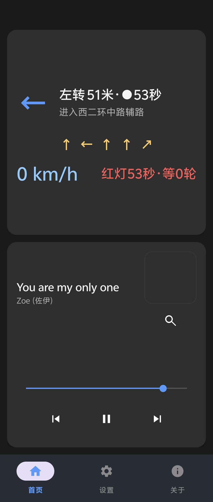
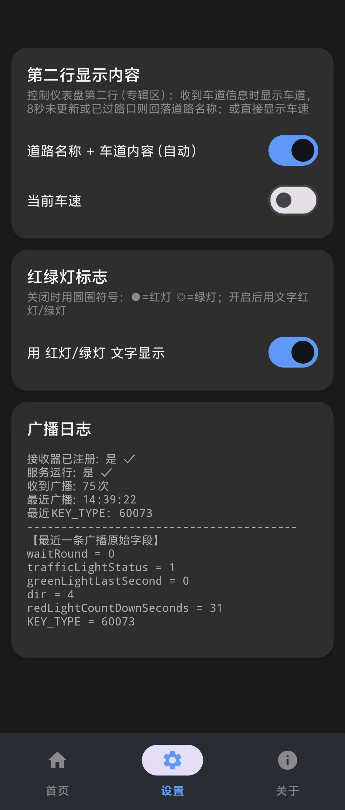
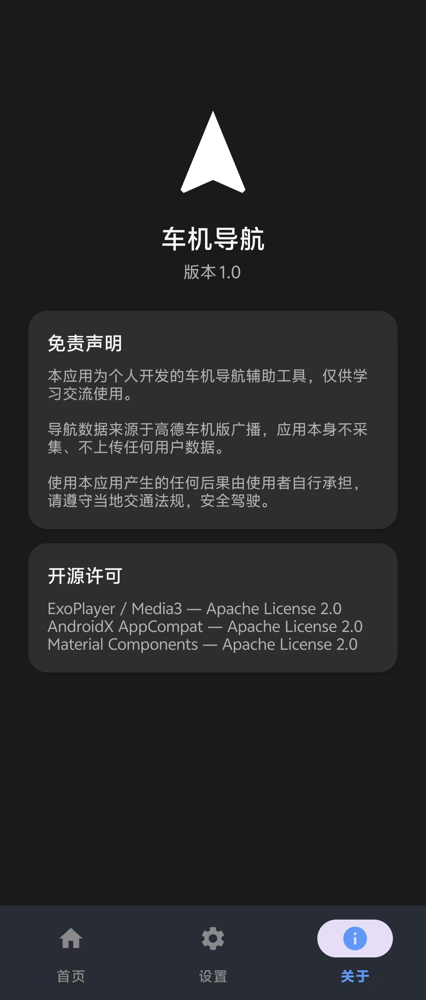
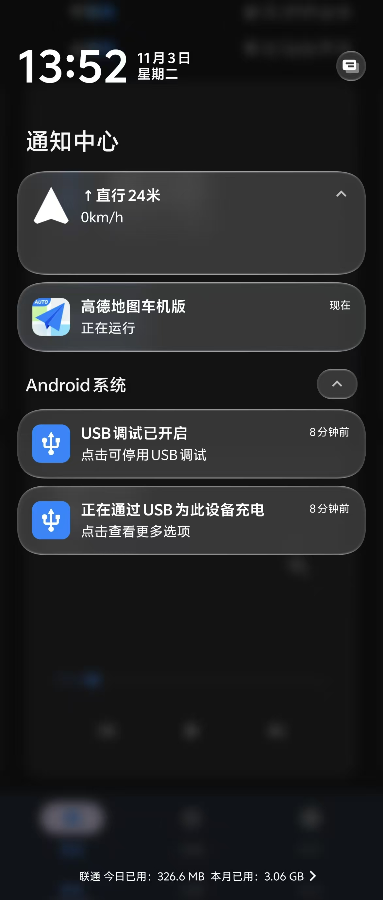

# 仪表盘导航 · car-dash-x

一个把**高德地图车机版**的导航信息，红绿灯读秒，道路提示，车道提示信息「钩」到 **2017 款日产奇骏仪表盘**的小工具，（理论上蓝牙音乐在播放时能显示到车辆仪表盘歌曲名和歌手的都支持）。本项目只是想折腾一些老油车，在不另外买配件的情况下给大家提供一些方便的小功能，比如红绿灯读秒和车道提示，在使用过程中，还请大家注意路面安全，遵守交通规则，请勿在行驶中操作手机。

> **原理**：高德车机版导航时会发送普通广播 `AUTONAVI_STANDARD_BROADCAST_SEND`，
> 本 App **无需任何权限**即可收到；解析出**转向 / 路名 / 距离 / 红绿灯读秒 / 车道指引**，
> 再通过**蓝牙 AVRCP 元数据**（共享 MediaSession，音乐不中断）显示到车机仪表盘的
> 「歌名区 + 专辑区」两行文字上。

---

## 界面截图

| 首页（导航 HUD + 播放器） | 设置（第二行显示 + 广播日志） |
| --- | --- |
|  |  |

| 关于（版本 / 开源 / 免责声明） | 通知栏（本 App + 高德车机版） |
| --- | --- |
|  |  |

---

## 功能

- **导航 HUD**：大箭头 + 转向指令 + 距离 + 当前车速 + 红绿灯读秒 + 车道指引。
- **音乐播放器**：扫描本地音乐、上一首 / 播放暂停 / 下一首，支持**方向盘（蓝牙 AVRCP）切歌**。
- **第二行显示可选**：道路名称和车道内容 / 当前车速（二选一，开关即生效）。
- **设置页广播日志**：实时显示收到的车机版广播原始字段，便于排查。

---

## 使用方法

### 1. 安装并开启高德地图车机版

需要安装并**开启高德地图车机版**（`amapauto`，**不是**手机版高德地图），只有车机版才会发送标准广播。

### 2. 安装本 App 并授权

安装 `app-release.apk`，首次打开授予**通知**和**音频**权限。

### 3. 蓝牙连接车机

手机蓝牙连接 2017 款日产奇骏，确保 **A2DP / AVRCP** 通路正常（能听到手机音乐）。

### 4. 扫描并播放本地音乐

打开 App → 首页播放器点**扫描本地音乐**（放大镜图标）→ 仪表盘应显示当前歌曲名 / 歌手。

### 5. 开始导航

在**高德地图车机版**中开始导航 → 首页 HUD 实时刷新，仪表盘两行显示：

- **第一行（歌名区）**：方向箭头 + 转向指令 + 距离 · 红绿灯读秒
- **第二行（专辑区）**：按设置页二选一显示（道路名称和车道内容 / 当前车速）

### 6. 方向盘切歌

导航过程中音乐照播，方向盘**上一首 / 下一首**可切换本地歌曲。

---

## 构建

### 方式一：从 GitHub Releases 直接下载（推荐）

项目发布到 GitHub 后，可直接到 **Releases 页面**下载最新版 APK 安装，无需自己打包：

https://github.com/Extremebin/car-dash-x/releases/tag/1.0.0

下载 `app-release.apk` 后安装即可（`adb install -r app-release.apk`）。

### 方式二：本地打包

```bash
cd car-dash-x
./gradlew assembleDebug        # 调试包（未签名）
# 产物：app/build/outputs/apk/debug/app-debug.apk

./gradlew assembleRelease      # 发布包（需签名，见下）
# 产物：app/build/outputs/apk/release/app-release.apk
```

> **发布签名**：`assembleRelease` 需要 `jks/release.jks` 密钥库和 `jks/keystore.properties`
> 签名配置（`storePassword` / `keyAlias` / `keyPassword`）。请**妥善保管 `jks/` 目录**，
> 切勿提交到仓库或泄露——一旦丢失将无法升级已发布的 App。
> 若 `keystore.properties` 缺失，`assembleRelease` 会自动跳过签名（仅生成未签名包）。


---

## 已知限制

### 1. 仪表盘最上方的「歌曲」标签无法替换

2017 款日产奇骏仪表盘上方是**一行固定文字「歌曲」**，这是**车机固件写死**的标签，AVRCP 只能修改它**后面**的文本内容，无法隐藏或替换「歌曲」二字本身。

因此导航时，本 App 只能把导航信息写入「歌曲」后面的**歌名区**，仪表盘顶部会始终显示成 `歌曲 + 转向指令` 的形式，前面的「歌曲」标签无法去掉。

### 2. 无法使用第三方音乐播放器的原因

蓝牙 AVRCP 元数据来自**当前活跃的 MediaSession**——同一时刻车机只能接收到**一个**会话的元数据。第三方音乐播放器（如手机上的音乐 App）播放时会自行创建 MediaSession 并成为活跃会话，从而**顶掉**本 App 的导航元数据：仪表盘会显示第三方歌曲名，导航信息就看不到了。

因此本 App **内置了本地 ExoPlayer** 作为播放器，把 MediaSession 控制在自己手里，确保**导航元数据始终优先显示**、音乐播放不中断；如果改用第三方播放器，导航信息会被其歌曲信息覆盖，两者无法同时兼顾。

---

## 未来构想

以下为当前方案 A（AVRCP 通道）之外的两条备选路线，作为**未来扩展方向**，尚未实现。

### 方案 B：内嵌高德导航 SDK（MotoNav 式）

**核心思路**：不再监听官方高德 App 的通知，而是在**自己 App 里内嵌高德官方导航 SDK（`AMapNavi`）自行导航**，通过 SDK 的**结构化回调**直接拿到转向动作、路名、距离、剩余里程等字段，再经同一套 AVRCP 通道推送到仪表盘。数据更可靠，但门槛更高。

- **数据源**：`AMapNaviListener.onNaviInfoUpdated(NaviInfo)` 提供结构化字段——`iconType`（转向动作）、`curStepRetainDistance`（距下一转向）、`nextRoadName`/`currentRoadName`（路名）、`pathRetainDistance`/`pathRetainTime`/`routeRemainLightCount`（剩余里程/时间/红绿灯）。
- **短文本措辞**：`沿 XX路 直行` / `右转 XX路` / `进入 XX路` / `前方为目的地`。
- **距离处理**：≥1 公里精确到 100 米、<1 公里精确到 1 米；两次 SDK 数据之间按车速每 100ms 推算，让数字连续下降。
- **门槛**：需申请高德 Android SDK Key（绑定包名 + 发布证书 SHA1）；导航入口变为**在你自己 App 里导航**（无官方界面 / 上岛 / 路况）；SDK 体积较大。
- **输出端复用**：方案 B 的输出端（MediaSession / AVRCP）与方案 A **完全通用**，只需把输入端从「通知监听」换成「SDK 回调」。

### 方案 C：CarPlay / ICCoA 转接盒通道

**核心思路**：用 CarPlay / ICCoA 转接盒把导航文字显示到仪表盘。链路：`手机（ICCoA）→ 转接盒（ICCoA→CarPlay）→ 车机（CarPlay）→ 仪表盘`。连接 CarPlay 后仪表盘显示 "Smart Phone"、下方空白。

- **协议证据**：ICCoA 原生携带结构化媒体 / 导航元数据——`MusicInfo`（歌名/歌手/专辑/歌词/封面/进度）与 `NavigationInfo`（标题/操作/距离/方向图标）。
- **关键结论**：空白区能否显示文字**完全取决于两处车端固件**——① 转接盒是否把 ICCoA `MusicInfo` 转成 CarPlay "Now Playing"（多数便宜盒子只转视频+音频）；② 2017 款奇骏车机是否把 CarPlay 元数据转发到仪表盘。两者外部均无法控制。
- **判定实验**：用转接盒连 CarPlay，播放真实音乐，看仪表盘空白区是否出现歌名/歌手——出现则通道通，空白则此路不通。
- **实测结论（2026-10-29）**：让 vivo 作 ICCoA 接收端（MiAuto）在**非 root 零售手机上不可行**——ICCoA 视频/音频数据通道走 WiFi P2P/SoftAP，建热点需 `NETWORK_STACK`/`TETHER_PRIVILEGED` 等**特权级权限**，零售 App 拿不到。此路在现有硬件上判定为**断**，除非 root 或换真正的安卓车机头机。

---

## 免责声明

本应用为个人开发的**仪表盘导航辅助工具**，仅供学习交流使用。

- 导航数据来源于高德车机版广播，本应用**不采集、不上传**任何用户数据。
- 使用本应用产生的任何后果由使用者自行承担。
- 请遵守当地交通法规，**安全驾驶**，请勿在行驶中操作手机。

## 开源许可

- 本应用及依赖（Media3 / ExoPlayer、AndroidX AppCompat、Material Components）均基于 **Apache License 2.0**。
